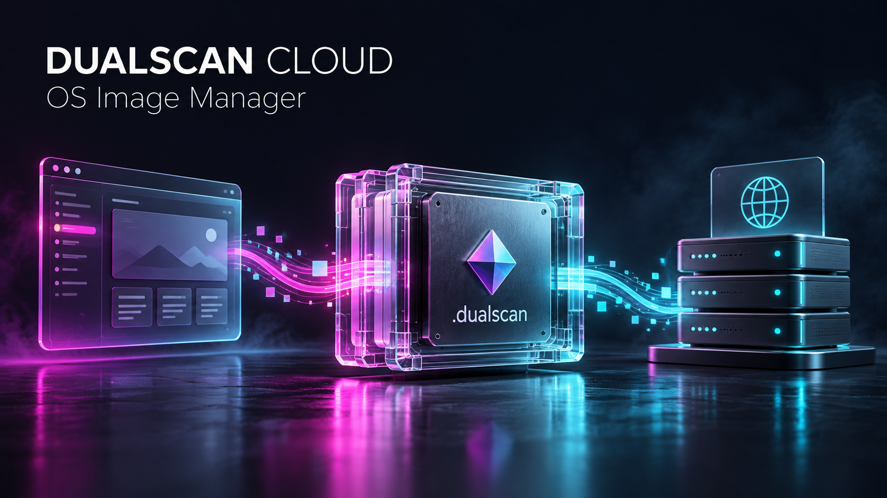
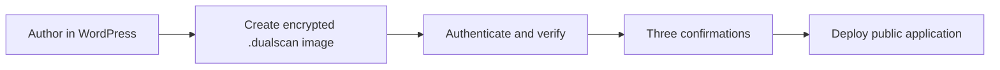
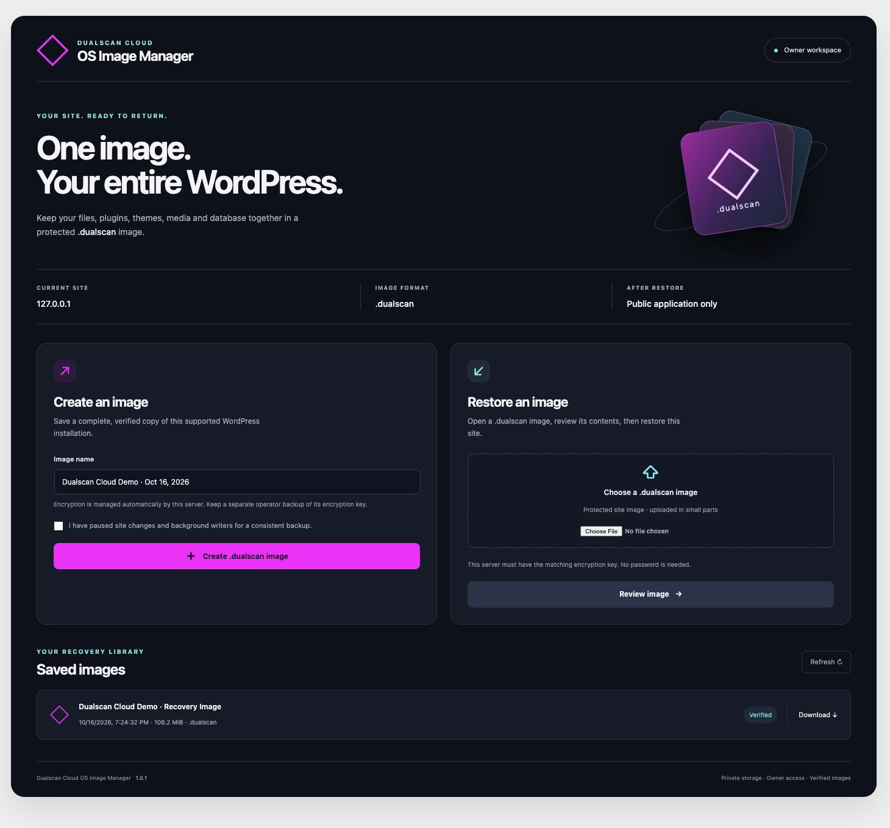
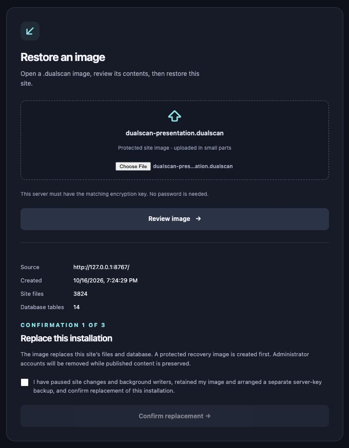
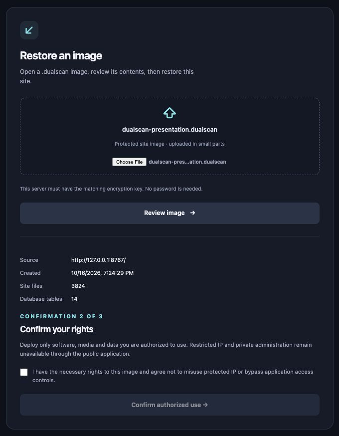
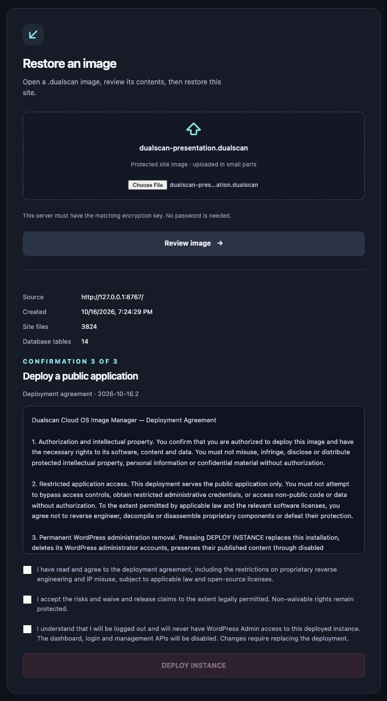

# Dualscan™ Cloud OS Image Manager

### Author your WordPress application. Deploy its public experience.

Turn a supported WordPress installation into an encrypted **`.dualscan` application image**: files, plugins, themes, media and database together. Authenticate the image, review three explicit confirmations, then deploy a public application with WordPress web administration removed.

**Version 1.0.1** · **GPL-2.0-or-later** · PHP 8.2+ · Single-site WordPress

[Download the plugin](dist/dualscan-cloud-os-image-manager-1.0.1.zip) · [Download source](dist/dualscan-cloud-os-image-manager-1.0.1-source.zip) · [Technical guide](docs/TECHNICAL-GUIDE.md) · [Key provisioning](docs/SERVER-KEYS.md) · [Visual presentation](docs/presentation.html)

## The idea

WordPress is the publisher's authoring environment. A `.dualscan` image carries the supported application state into a deployed public runtime. The publisher can author the next version separately and replace the deployment with a new verified image.

| Capture | Protect | Verify | Deploy |
| --- | --- | --- | --- |
| Local site files, plugins, themes, media and supported database tables | AES-256-GCM with a private server key and plugin-folder derivation context | Complete image authentication, paths, file hashes and database row digests | Encrypted recovery point, administrator removal, session invalidation and a sealed public runtime |

The original site stays an authoring workspace. Creating an image does not remove its accounts. Sealing applies to the restored deployment.

## The actual application

No image-password prompts. A random master key stays in durable private storage outside the website; the installed plugin-folder name supplies its identifier and derivation context. A destination operator provisions the matching key separately. **Keep the key backup: an image cannot be restored without it.**

## Recovery, with three deliberate confirmations

These are screenshots of the running 1.0.1 application inspecting a real encrypted image. The final agreement was left unchecked and no deployment was submitted for these captures.

<table>
<tr><th>1 · Replace this installation</th><th>2 · Confirm your rights</th><th>3 · Agreement and deployment</th></tr>
<tr>
<td valign="top"></td>
<td valign="top"></td>
<td valign="top"></td>
</tr>
</table>

The final **DEPLOY INSTANCE** button requires all agreement acknowledgments. Approvals are enforced on the server, bound to the owner, exact image hash and agreement version, expire after 30 minutes and authorize a single deployment job.

After a successful deployment, administrative principals are removed, supported authored content is reassigned to a disabled attribution principal, stored sessions and application passwords are cleared, and the browser is logged out and returned to the homepage. WordPress login, dashboard, management APIs and related endpoints are denied. Host-level front-controller rules cover standalone scripts that do not initialize WordPress.

## Inside the image

- Regular local files and directories under the supported WordPress root, including core, active/inactive plugins, themes, uploads and configuration.
- All visible supported base tables in the connected database, including tables without the WordPress prefix.
- A manifest with exact file lengths and SHA-256 hashes, database definitions and row verification data.
- Authenticated encryption with fresh per-image salt/nonces and an authenticated terminal boundary.

Server keys are **never embedded** in the image, plugin package, browser JavaScript or source distribution. Inspect and restore require an existing matching key; they do not silently generate a replacement.

## Evidence and supported scope

Current source passed **41 engine tests, 21 keyring tests and 10 independent keyring checks**. The actual WordPress HTTP roundtrip exercised a **111 MB image, 14 database tables, 107 upload chunks, 17 rejected approval attempts, 23 sealed-access checks and 21 public-router cases**. Exact tested-source inventories and subsequent narrowly tested changes are recorded in [verification](verification/) and [delivery verification](docs/DELIVERY-VERIFICATION.md).

Version 1.0.1 supports a single-site installation, local regular files, supported InnoDB schemas and standard user tables, with a matching destination URL/table prefix. Unsupported layouts and unsafe foreign-key dependencies fail explicitly. Frontend features relying on login, REST, admin-ajax, direct PHP or writable runtime files need separate qualification.

A `.dualscan` file is a **WordPress application image**. Server packages, external services, DNS, TLS, database grants and infrastructure permissions are provisioned separately. Application policy cannot remove a hosting provider's server access. The included Docker/Nginx templates still require execution and validation on the target host.

## Public source release under GPL

The source declares **GPL-2.0-or-later**; see [LICENSE](LICENSE). Source rights to use, study, modify and redistribute covered software are distinct from access to a hosted instance. The draft deployment agreement preserves GPL and non-waivable rights; it does not make GPL code proprietary or prevent lawful modification of that code.

This **public source release is licensed under GPL-2.0-or-later**. [GPL release notes](docs/GPL-RELEASE-NOTES.md) cover license notices, corresponding source and separation of private operational data. Publishing the source does not deploy a hosted instance or constitute WordPress.org directory submission.

## Build and operate

1. Install the plugin ZIP on the trusted authoring site and configure durable private storage.
2. Back up and provision the server key through the offline operator tool.
3. Pause writers, create an image, then authenticate and review it at the destination.
4. Complete the three confirmations and deploy the public runtime.

[CLI documentation](bin/README.md) · [Server-key setup](docs/SERVER-KEYS.md) · [Deployment templates](deployment/README.md) · [Security review](docs/SECURITY-REVIEW.md) · [Capture provenance](docs/PRESENTATION-VERIFICATION.md)

Build delivery archives with `python3 tools/build-release.py`. Artifact checksums are in [dist/SHA256SUMS](dist/SHA256SUMS). The header is concept artwork; the interface images are actual application captures.
